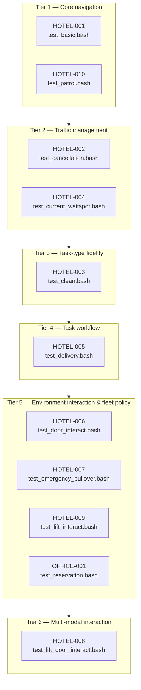

## **What Is This?**

This repository provides a smoke test suite that executes integrated end-to-end checks using Open-RMF's in-built simulations.

## **Test Matrix**

Below is a tabular listing of test cases, captured in terms of individual `.bash` scripts, and their corresponding proof of functionality:

| Test ID | Test Script | Component / Feature | Test Description | Expected Result (Pass Criteria) |
|---|---|---|---|---|
| HOTEL-001 | `hotel/test_basic.bash` | Navigation — go-to-place | Dispatches `tinyBot_1` to `lobby` in the `hotel` simulation and waits for task completion. | Task completes within the 200 s timeout; script does not print `Test failed`. |
| HOTEL-002 | `hotel/test_cancellation.bash` | Task cancellation & conflict resolution | Sends `deliveryBot_1` and `tinyBot_1` to the same `restaurant` (creating a conflict), queues a follow-up task for `deliveryBot_1` to `kitchen`, then cancels its in-progress task. | TinyBot's task completes with `restaurant` freed; `deliveryBot_1` is at `kitchen` and its follow-up task completes; no timeouts/assertion failures. |
| HOTEL-003 | `hotel/test_clean.bash` | Cleaning task | Dispatches a specialized cleaning task for `cleanerBotA_2` at `clean_waiting_area` and waits for completion. | Cleaning task completes within the 500 s timeout. |
| HOTEL-004 | `hotel/test_current_waitspot.bash` | Wait-spot allocation | Sends `deliveryBot_1` and `tinyBot_1` both to the constrained `restaurant`; while `tinyBot_1` is the requester, `deliveryBot_1` must be allocated `kitchen` as its wait spot. | `tinyBot_1` reaches `restaurant`; `deliveryBot_1` is verified at `kitchen` (wait spot) and its task completes. |
| HOTEL-005 | `hotel/test_delivery.bash` | Delivery workflow (dispenser + ingestor) | Dispatches a delivery for `deliveryBot_1` from the `hotel_kitchen_dispenser` at `kitchen` to the `guest_receiver` at `L2_master_suite`, publishing 10× `dispenser_results` and 10× `ingestor_results` at each stop. | Robot reaches `kitchen`, then `L2_master_suite` after simulated dispenser/ingestor results; delivery task completes. |
| HOTEL-006 | `hotel/test_door_interact.bash` | Door interaction | Sends `deliveryBot_1` to `kitchen` and `cleanerBotA_2` to `clean_lobby`, forcing the navigation system to orchestrate door opening/closing safely along their routes. | Both go-to-place tasks complete within the 200 s timeouts without door-related failures. |
| HOTEL-007 | `hotel/test_emergency_pullover.bash` | Emergency pullover & resume | Tasks `deliveryBot_1` to `restaurant`, then triggers an emergency alarm (`/emergency_signal` or `/fire_alarm_trigger` depending on `ROS_DISTRO`), verifies pullover, then clears the alarm. | `deliveryBot_1` parks at `deliverybot_charger` during the alarm; after the alarm clears it resumes and completes the task. |
| HOTEL-008 | `hotel/test_lift_door_interact.bash` | Lift + door interaction (multi-modal) | Tasks `deliveryBot_1` to `L3_master_suite`, which requires sequentially engaging the lift and door mechanisms across floors. | Task completes within the 200 s timeout; lifts and doors engaged without failure. |
| HOTEL-009 | `hotel/test_lift_interact.bash` | Lift interaction | Tasks `deliveryBot_1` to `L3_room1`, bridging multiple floors via the simulated lift. | Task completes within the 200 s timeout with successful lift engagement. |
| HOTEL-010 | `hotel/test_patrol.bash` | Patrol task (multi-waypoint) | Issues a multi-waypoint patrol for `tinyBot_1` across `lobby` and `shop` for 2 rounds. | Patrol loop completes all 2 rounds within the 500 s timeout. |
| OFFICE-001 | `office/test_reservation.bash` | Parking reservations | With `use_parking_reservations: True`, occupies `pantry` with `tinyRobot2`, dispatches `tinyRobot1` to the same occupied `pantry`, then frees `pantry` by moving `tinyRobot2` to `lounge`. | RMF diverts `tinyRobot1` to the nearest parking spot `tinyRobot2_charger`; once `pantry` is freed, `tinyRobot1` moves to `pantry`; final assertions: `tinyRobot1` at `pantry` and `tinyRobot2` at `lounge` all pass. |

## **Test Hierarchy**

All tests are ordered from the most fundamental capability (single-robot navigation) to the most complex (multi-modal, multi-floor interaction). Each test gates the ones that depend on its capability.

