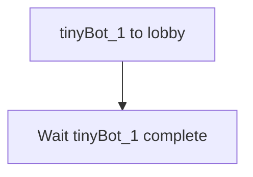
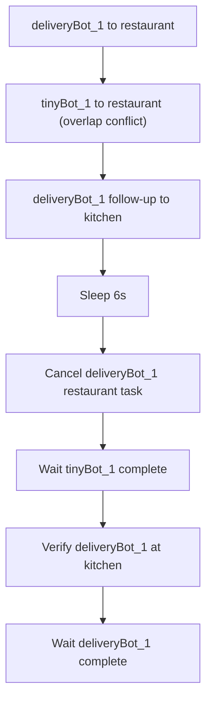
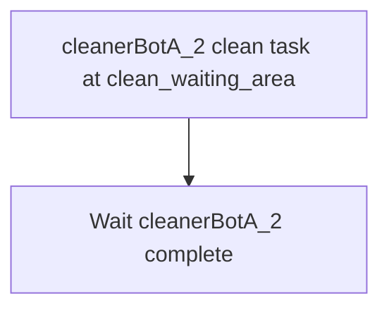
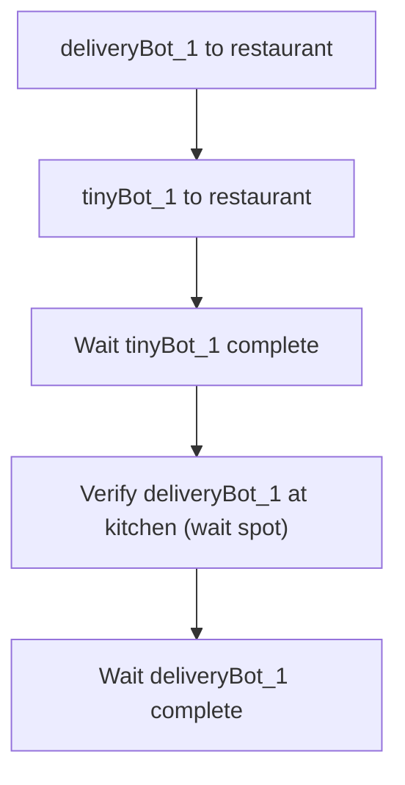
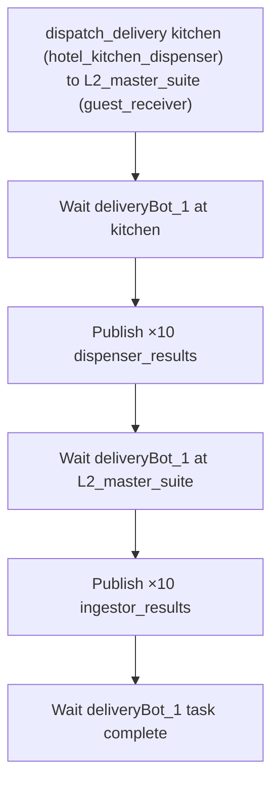
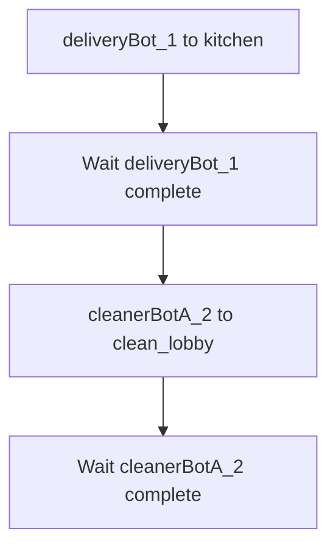
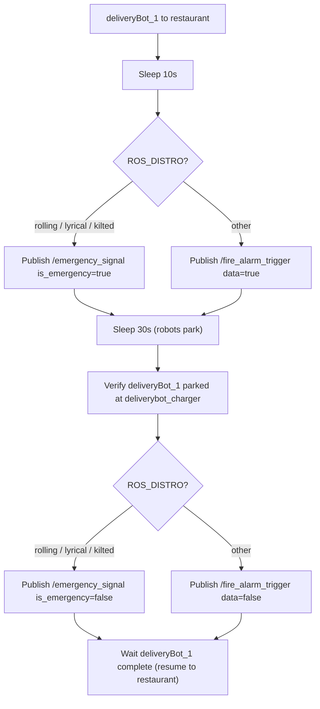
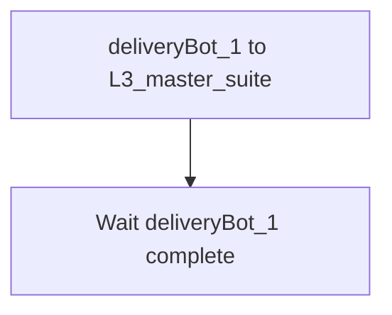
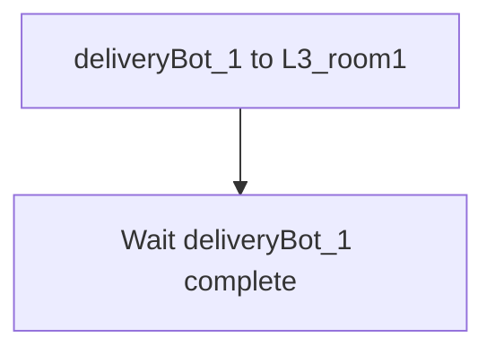
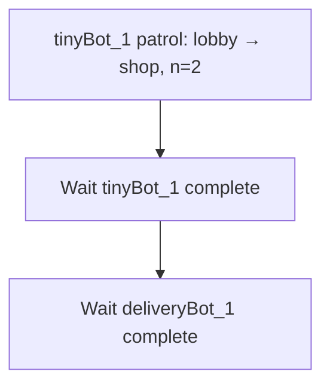

# Open-RMF High-Level Stress Tests

This folder contains bash scripts for high-level integration tests of Open-RMF. Each script dispatches tasks via `rmf_demos_tasks` (go-to-place, patrol, clean, delivery) across the fleets (`tinyRobot`, `cleanerBotA`, `deliveryRobot`) and verifies completion.

> [!NOTE]
> These stress tests are all based in the `hotel` simulation.

> [!IMPORTANT]
> All scripts assume the simulation has been **restarted** immediately before execution, so that every robot is at its default position. No robot initialization is performed inside the scripts.

## test_basic

Sends `tinyBot_1` to `lobby`, verifying that Open-RMF can plan and execute a basic navigation task seamlessly.

## test_cancellation

Creates a conflict by sending `deliveryBot_1` and then `tinyBot_1` to `restaurant`, followed by a follow-up task for `deliveryBot_1` to `kitchen`. Cancels `deliveryBot_1`'s first task halfway through, verifying that it immediately proceeds to `kitchen`, freeing up `restaurant` for `tinyBot_1`.

## test_clean

Verifies that the `cleanerBotA_2` robot can properly execute a specialized cleaning task by dispatching it to `clean_waiting_area` and waiting for completion.

## test_current_waitspot

Verifies correct wait-spot behavior by dispatching `deliveryBot_1` and `tinyBot_1` to the same constrained location (`restaurant`). While `tinyBot_1` arrives at `restaurant`, `deliveryBot_1` is allocated `kitchen` as its wait spot. After `tinyBot_1` completes, the script verifies `deliveryBot_1` held position at `kitchen`.

## test_delivery

Dispatches a delivery task from the `hotel_kitchen_dispenser` at `kitchen` to the `guest_receiver` ingestor at `L2_master_suite` for `deliveryBot_1`. Waits for the robot at each stop and artificially publishes the dispenser and ingestor task results (10× each) to ensure the RMF integration workflow successfully runs end-to-end.

## test_door_interact

Tests physical object interactions securely by sending `deliveryBot_1` to `kitchen` and `cleanerBotA_2` to `clean_lobby`, forcing the navigation system to orchestrate opening and closing of doors safely along the routes.

## test_emergency_pullover

Starts a task to `restaurant` for `deliveryBot_1` and triggers an emergency alarm to force pullover behaviors. The alarm topic is selected based on `ROS_DISTRO`: `emergency_signal` (`EmergencySignal`) on rolling/lyrical/kilted, `fire_alarm_trigger` (`Bool`) on other distros. After the robot parks at `deliverybot_charger`, the alarm is disabled and the robot is expected to resume and complete its task.

## test_lift_door_interact

Tests a complex, multi-modal interaction sequence by tasking `deliveryBot_1` to `L3_master_suite`, which requires seamlessly engaging first with a lift mechanism and sequentially with door modules gracefully.

## test_lift_interact

Specifically tests the interaction protocol with the simulated lift by sending `deliveryBot_1` to `L3_room1`, bridging multiple floors flawlessly.

## test_patrol

Issues a multi-waypoint patrol for `tinyBot_1` across `lobby` and `shop` for 2 rounds, verifying that a baseline multi-waypoint patrol task executes to completion.

