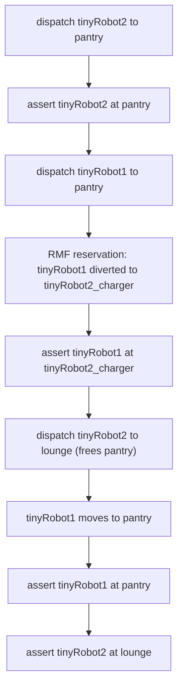

# Open-RMF High-Level Stress Tests — `office`

This folder contains bash scripts for high-level integration tests of Open-RMF in the `office` simulation. The script initializes robots from the `tinyRobot` fleet, dispatches tasks via `rmf_demos_tasks`, and verifies completed locations.

## Fleet configuration — `configs/tinyRobot_config.yaml`

A custom fleet config used by the tests. Key parameters:

| Parameter | Value | Notes |
|---|---|---|
| Robots | `tinyRobot1`, `tinyRobot2` | Home chargers `tinyRobot1_charger`, `tinyRobot2_charger` |
| `task_capabilities.loop` | `True` | Enables patrol tasks |
| `finishing_request` | `nothing` | Robots do not auto-park/charge on task completion (except when overridden by a task) |
| `responsive_wait` | `False` | Fleet-wide & per-robot default |
| `use_parking_reservations` | `True` | **Enabled — this is what the reservation test exercises** |
| `recharge_threshold` | `0.10` | Fleet will not operate below 10% battery |

## test_reservation

Exercises the RMF parking-reservation node (`use_parking_reservations: True`). It verifies that when a request for an occupied place is dispatched, RMF reserves the nearest parking spot instead, and that the original place becomes available as soon as the reserving robot leaves.

Sequence:

1. **`tinyRobot2` → `pantry`** and stays there (occupies the place).
2. **`tinyRobot1` → `pantry`** — the place is occupied, so the RMF reservation node sends `tinyRobot1` to `tinyRobot2_charger`, the parking spot closest to `pantry`.
3. **`tinyRobot2` → `lounge`** — `pantry` is now freed, so `tinyRobot1` moves on to `pantry`.
4. Both robots' final locations are asserted: `tinyRobot1` at `pantry`, `tinyRobot2` at `lounge`.



Each assertion uses `ros2 run rmf_demos_tasks get_robot_location ... -B <place> --timeout 500` and fails the script if the robot is not at the expected location.

## Prerequisites

- RMF simulation with the `office` map and the `tinyRobot` fleet running (simulation must use the config in `configs/tinyRobot_config.yaml`).
- ROS 2 environment with `rmf_demos_tasks` available.
- Simulation time enabled (`--use_sim_time`).

## Usage

```bash
cd office
chmod +x test_reservation.bash
./test_reservation.bash
```

The script prints `Test failed` and exits non-zero if any location assertion times out.
